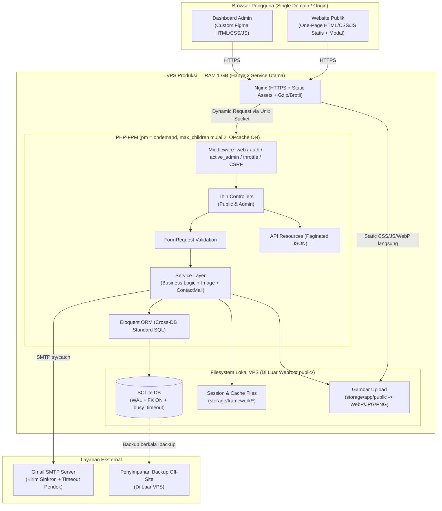
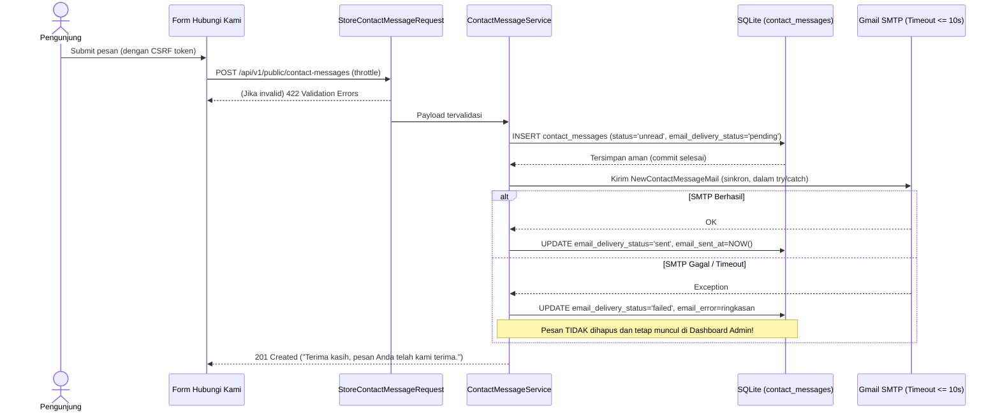

# 02 — Arsitektur Sistem & Aliran Data
## Website Resmi & Dashboard Admin AOCC Semarang (Low-Resource 1 GB RAM VPS)

**Versi Dokumen:** 2.0 (Dioptimalkan untuk VPS RAM 1 GB)  
**Tanggal:** 2026-11-24

> Lihat juga [07_LOW_RESOURCE_ARCHITECTURE.md](file:///c:/Users/shion/webaocc/docs/07_LOW_RESOURCE_ARCHITECTURE.md) untuk rincian tuning Nginx, PHP-FPM, estimasi RAM, strategi backup/restore SQLite, serta panduan migrasi ke MySQL/MariaDB.

---

## 1. Gambaran Umum Arsitektur Hemat Resource

Sistem AOCC Semarang menggunakan arsitektur **Monolitik Sederhana Single-Origin** dengan hanya **2 proses layanan aktif di VPS produksi**:
1. **Nginx** — Reverse proxy, terminasi HTTPS, kompresi HTTP, dan penyaji langsung file statis (HTML/CSS/JS build lokal & gambar WebP).
2. **PHP-FPM (`pm = ondemand`)** — Menjalankan Laravel 13 hanya ketika ada request dinamis masuk, dan otomatis mematikan worker idle untuk membebaskan RAM.

**Tidak ada** daemon database terpisah, **tidak ada** Redis, **tidak ada** queue worker permanen, dan **tidak ada** Node.js di VPS produksi.



---

## 2. Perubahan Penyederhanaan dari Rancangan v1.0 ke v2.0

| Komponen | Rancangan v1.0 (Sebelumnya) | Rancangan v2.0 (VPS RAM 1 GB) | Dampak Penghematan |
| :--- | :--- | :--- | :--- |
| **Database Awal** | MySQL Server (`mysqld`) | **SQLite** (WAL + FK ON + cross-DB migrations) | Menghemat ~250–450 MB RAM permanen & 1 daemon service. |
| **Session Driver** | `database` (tabel `sessions`) | **`file`** (`storage/framework/sessions`) | Menghilangkan write ke SQLite pada setiap request & mencegah lock contention. |
| **Cache Store** | `database` (tabel `cache`) | **`file`** (`storage/framework/cache/data`) | Rate limiter & cache tanpa Redis dan tanpa write lock di SQLite. |
| **Queue Connection** | `database` (+ worker) | **`sync`** (simpan DB dulu, SMTP langsung `try/catch`) | Menghilangkan proses worker permanen (~40–60 MB RAM). |
| **Tabel Konten Situs** | `site_settings` | **`site_contents`** | Penamaan lebih jelas & tepat 7 tabel domain tanpa tabel operasional ekstra. |
| **Build Frontend** | Tidak dibahas detail | **Build di komputer lokal** (`npm run build`), unggah hasil statis | Node.js tidak perlu berjalan atau terpasang di VPS. |

---

## 3. Struktur Folder Backend (Separation of Concerns)

Struktur tetap standar Laravel 13, tipis, dan bebas *over-engineering*:

```text
app/
├── Console/
│   └── Commands/
│       └── ProvisionAdminsCommand.php      # Provisioning aman 3 akun admin
├── Enums/
│   ├── ContactMessageStatus.php            # Unread, Read, Archived
│   ├── EmailDeliveryStatus.php             # Pending, Sent, Failed
│   └── SiteContentType.php                 # Text, LongText, Url, Image, Email
├── Http/
│   ├── Controllers/
│   │   ├── Public/                         # Website publik + API publik + form kontak
│   │   └── Admin/                          # Login/Logout + CRUD terproteksi
│   ├── Middleware/
│   │   └── EnsureAdminIsActive.php         # Pastikan admin is_active = true
│   ├── Requests/
│   │   ├── Public/                         # Validasi form Hubungi Kami
│   │   └── Admin/                          # Validasi Login & CRUD konten
│   └── Resources/
│       ├── Public/                         # Output publik aman (tanpa data internal)
│       └── Admin/                          # Output dashboard admin
├── Mail/
│   └── NewContactMessageMail.php           # Mailable notifikasi ke Gmail gereja
├── Models/                                 # 7 Eloquent Models + relasi + scope
└── Services/                               # Logika bisnis & transaksi
    ├── AdminAuthService.php
    ├── ContactMessageService.php
    ├── EventService.php
    ├── ImageStorageService.php
    ├── SermonService.php
    ├── SiteContentService.php
    └── WorshipService.php
```

---

## 4. Aliran Data Utama

### 4.1 Pengiriman Formulir Hubungi Kami (`QUEUE_CONNECTION=sync`, Zero Data Loss)



> **Mengapa SMTP diberi batas timeout pendek (misal 10 detik)?** Karena `QUEUE_CONNECTION=sync` berjalan di dalam request HTTP yang ditangani PHP-FPM (`pm.max_children` kecil). Timeout SMTP yang terukur mencegah worker PHP-FPM menggantung terlalu lama apabila koneksi ke Gmail sedang lambat.

### 4.2 Autentikasi Admin (Session File + Single Origin)
1. Admin mengakses `/admin/login` pada **origin/domain yang sama** dengan website publik.
2. `POST /admin/login` melewati middleware `web` + `throttle` (maks 5 percobaan/menit per `username|ip`, tersimpan di `CACHE_STORE=file`).
3. `Auth::attempt(['username' => $username, 'password' => $password, 'is_active' => true])` memverifikasi Bcrypt hash terhadap tabel `users`.
4. Jika berhasil: `$request->session()->regenerate()`, session ditulis ke file lokal (`storage/framework/sessions`), `last_login_at` diperbarui, dan browser menerima cookie session (`HttpOnly`, `SameSite=Lax`, `Secure=true` di produksi HTTPS).
5. Tidak ada registrasi publik, tidak ada reset password publik, dan tidak ada CORS lintas domain yang rumit.

### 4.3 Provisioning 3 Akun Admin
- Menggunakan Artisan command interaktif: `php artisan aocc:provision-admins`.
- Input password menggunakan `$this->secret()` (tidak muncul di layar maupun shell history), validasi minimal 12 karakter, dan otomatis di-hash (Bcrypt 12 rounds).
- Tidak ada kredensial asli di source code, migrasi, seeder publik, dokumentasi, atau GitHub.

---

## 5. Konfigurasi Laravel (`.env.example` Target Low-Resource)

Seluruh pengaturan disesuaikan dengan **Laravel 13** (`config/database.php`, `config/session.php`, `config/cache.php`, `config/mail.php`):

```dotenv
APP_NAME="AOCC Semarang"
APP_ENV=local
APP_KEY=
APP_DEBUG=true
APP_URL=http://localhost:8000
APP_TIMEZONE=Asia/Jakarta

APP_LOCALE=id
APP_FALLBACK_LOCALE=id
APP_FAKER_LOCALE=id_ID

BCRYPT_ROUNDS=12

LOG_CHANNEL=daily
LOG_LEVEL=warning

# Database — SQLite (Lokasi di luar public/ & di luar Git)
DB_CONNECTION=sqlite
# Di lokal default: database/database.sqlite
# Di VPS produksi gunakan path absolut di luar public/, misal: /var/lib/aocc/aocc.sqlite
DB_DATABASE=
DB_FOREIGN_KEYS=true
DB_SQLITE_BUSY_TIMEOUT=5000
DB_SQLITE_JOURNAL_MODE=WAL
DB_SQLITE_SYNCHRONOUS=NORMAL

# Session, Cache & Queue — Hemat RAM (Tanpa Redis & Tanpa Queue Worker)
SESSION_DRIVER=file
SESSION_LIFETIME=120
SESSION_ENCRYPT=false
SESSION_HTTP_ONLY=true
SESSION_SAME_SITE=lax
SESSION_SECURE_COOKIE=false

CACHE_STORE=file
QUEUE_CONNECTION=sync

# Storage Upload Gambar (Path di database, BUKAN BLOB)
FILESYSTEM_DISK=public

# Mail — Gmail SMTP (App Password hanya di .env server, JANGAN commit)
MAIL_MAILER=smtp
MAIL_SCHEME=smtps
MAIL_HOST=smtp.gmail.com
MAIL_PORT=465
MAIL_TIMEOUT=10
MAIL_USERNAME=
MAIL_PASSWORD=
MAIL_FROM_ADDRESS="noreply@aoccsemarang.org"
MAIL_FROM_NAME="${APP_NAME}"
MAIL_CHURCH_TO_ADDRESS="aoccsemarang@gmail.com"
```

> **Catatan `LOG_CHANNEL=daily`:** Menggunakan rotasi log harian (default Laravel menyimpan 14 hari) mencegah file `laravel.log` membengkak menghabiskan disk VPS.
> **Catatan Produksi:** Wajib ubah `APP_ENV=production`, `APP_DEBUG=false`, `APP_URL=https://domain-resmi`, dan `SESSION_SECURE_COOKIE=true`.
